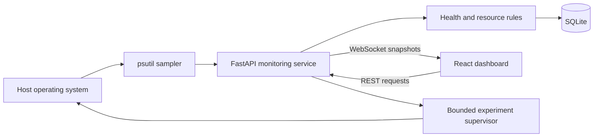
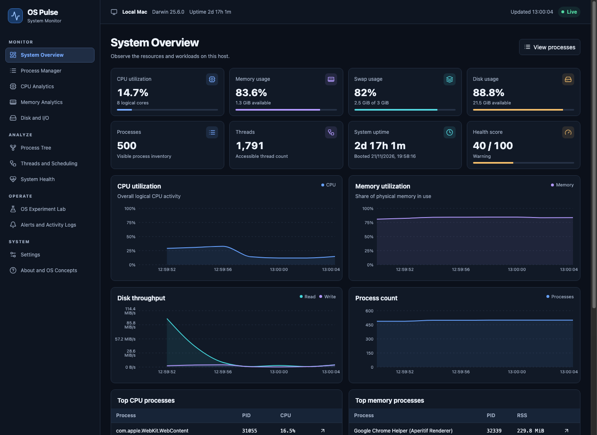

# OS Pulse

Real-Time System Monitor and Process Manager for a fifth-semester B.Tech Operating Systems course.

System tools expose counters and process lists across several screens. OS Pulse brings those observations together and adds a controlled lab for connecting the measurements to scheduling, memory management, synchronization, and process lifecycle concepts.

## Run locally

Use Python 3.11 or later and Node.js 22 LTS or later. Run commands from the repository root as your normal account. On Apple Silicon, use an arm64 Python and Node installation for native execution.

**macOS and Linux**

```sh
python3 -m venv .venv
source .venv/bin/activate
python -m pip install -r requirements.txt
npm --prefix frontend ci
```

**Windows PowerShell**

```powershell
py -3 -m venv .venv
.venv\Scripts\python.exe -m pip install -r requirements.txt
npm --prefix frontend ci
```

Start the backend and frontend in separate terminals. Activate the virtual environment first, or use its Python executable directly.

```sh
python -m uvicorn backend.main:app --host 127.0.0.1 --port 8000
```

```sh
npm --prefix frontend run dev
```

Open [OS Pulse](http://127.0.0.1:5173). The interactive API reference is at [FastAPI Swagger UI](http://127.0.0.1:8000/docs). To review the production bundle locally, run `npm --prefix frontend run build` and `npm --prefix frontend run preview`, then open [the preview](http://127.0.0.1:4173).

Keep both servers on loopback. Use one Uvicorn worker so sampling, experiment ownership, and session authorization remain in the same process. SQLite defaults to `~/.os-pulse/pulse.sqlite`. Set `OSPULSE_DB` to use another writable location.

## Features

- **System Overview** streams host CPU, RAM, swap, capacity, I/O, process and thread counts, uptime, and health. It includes CPU and RSS rankings and host information.
- **Process Manager and Process Tree** use PID and PPID data from the host. Search, sort, filter, inspect threads and process counters, and request supported process operations with explicit confirmation.
- **CPU, Memory, Disk, and Thread analytics** show platform-provided counters and separate conceptual explanations. Missing or restricted readings are unavailable.
- **Health and alerts** explain weighted deductions, threshold observations, and recommendations. SQLite retains alerts, activity, and metric history for seven days. CSV exports are available from the log page.
- **Experiment Lab** runs eight bounded workloads covering CPU stress, memory residency, threaded I/O, multiprocessing, process lifecycle, race conditions, producer–consumer synchronization, and circular waits.
- **Settings** persist sampling and alert thresholds in SQLite. Theme preference stays in the browser.

## Architecture

React and Vite provide the local interface. Tailwind CSS and custom styles provide the visual system, Recharts renders metrics, React Flow renders the lazily loaded process hierarchy, Lucide supplies icons, and Framer Motion handles page transitions. FastAPI validates requests with Pydantic, uses psutil for real measurements and process operations, and publishes snapshots over WebSockets. The asyncio service moves blocking reads and SQLite writes off the event loop. Experiment roots use Python's spawn context and supervise bounded multiprocessing and threading workloads.



## Project layout

```text
backend/
  main.py           Application, REST routes, WebSocket and sampler lifecycle
  sampling.py       Host counters, cached information, process inventory
  processes.py      Process inspection and guarded control
  health.py         Health normalization and observation rules
  experiments.py    Bounded workloads and cleanup
  models.py         Request schemas
  store.py          SQLite, audit, alert cooldown, CSV
frontend/
  index.html        Browser entry point
  src/
    main.jsx        Layout, navigation and startup
    data.js         API, reconnect and formatting
    components.jsx  Charts, metrics and common UI
    analytics.jsx   Overview, analytical pages and concepts
    processes.jsx   Process table and inspection
    tree.jsx        Process hierarchy
    operations.jsx  Experiments, alerts and preferences
    style.css       Responsive layout and themes
tests/              pytest coverage
docs/               Course report, viva, demo, architecture and API reference
```

## Health score

CPU, available-memory pressure proxy, swap occupancy and disk capacity occupancy use percentage readings. The load component uses the one-minute load average divided by the logical CPU count, expressed as a percentage. Average each available component over the last 30 seconds of samples, clamp it to 0–100, and redistribute missing component weights proportionally. The score is 100 minus the weighted pressure, rounded to an integer.

| Component | Initial weight |
|---|---:|
| CPU | 30% |
| Memory | 30% |
| Swap | 15% |
| Disk capacity | 15% |
| Load | 10% |

Scores of 80–100 are Healthy, 60–79 Moderate, 40–59 Warning, and 0–39 Critical. This application-defined heuristic summarizes resource occupancy. The same score can describe hosts with different workloads and response times.

## Security and platform limits

- Keep access local. The backend rejects unrecognized Host headers and origins and issues a per-launch token for mutations. Any application running as the same local user can potentially access loopback.
- Process operations check creation time, ownership, protected processes, and OS permissions. macOS and Linux grace periods and signal handling depend on the target process. Windows exposes priority classes, and graceful termination is unavailable for arbitrary Windows processes.
- macOS may omit process I/O, CPU frequency, I/O wait, and memory fields such as cached bytes. Sandboxed execution can restrict more counters. Process CPU time, RSS and thread data are limited to what the normal user can inspect.
- CPU percentages are sampled. Values can be noisy during startup, and a per-process value can exceed 100% when the process occupies multiple logical CPUs.
- Load average, swap I/O, context switches and disk counters differ by platform. Mounted volumes can share storage. Disk I/O shows counter deltas aggregated by psutil. No inference is made about individual physical-device latency.
- The RAM cap is the smaller of 256 MiB and one eighth of available physical memory when checked. The OS can reclaim or consume memory between readings. Short experiments can finish between host sampling ticks.

## Verification

```sh
python -m pip install -r requirements-dev.txt
python -m pytest -q
npm --prefix frontend run lint
npm --prefix frontend run build
```

See the [project report](docs/PROJECT_REPORT.md) for measured resource usage and test scope. Native verification was performed on arm64 macOS. Linux and Windows paths are implementation targets and require platform testing.

## Course materials

- [Architecture](docs/ARCHITECTURE.md)
- [Operating systems concepts](docs/OS_CONCEPTS.md)
- [API reference](docs/API_REFERENCE.md)
- [32 viva questions and answers](docs/VIVA_QUESTIONS.md)
- [Five-minute demo](docs/DEMO_GUIDE.md)
- [Project report](docs/PROJECT_REPORT.md)

Future work includes Linux and Windows CI, per-volume native counters, a representative baseline for I/O anomaly detection, and configurable export time ranges.

## Running application

The dashboard below was captured from the native macOS verification run. The hostname was replaced in the screenshot.


